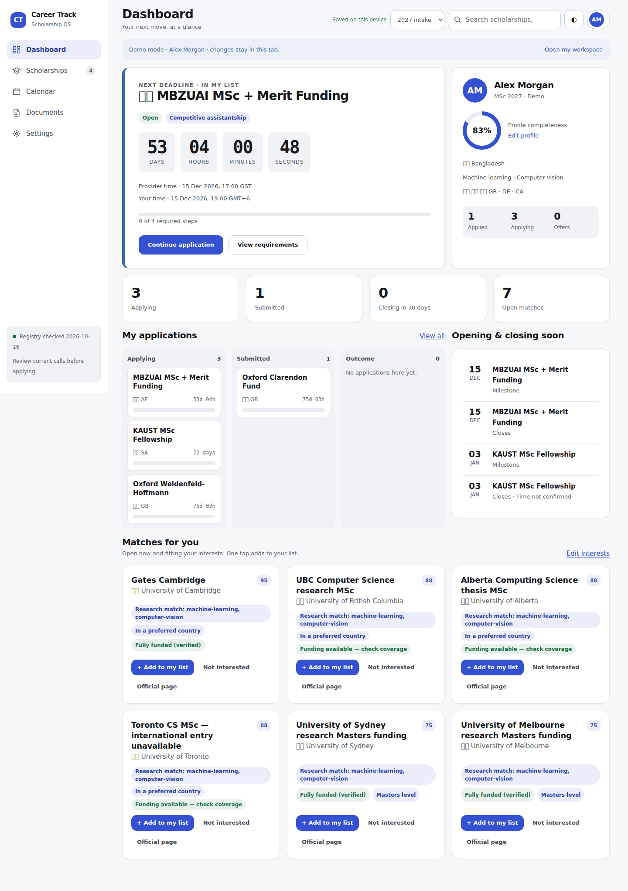

# Career Track — Scholarship OS

A local-first workspace for scholarship deadlines, country trade-offs, applications and documents.

**V4 is live:** [muncareer.vercel.app](https://muncareer.vercel.app) · [Try the fictional demo](https://muncareer.vercel.app/?demo=1) · [Classic tools](https://muncareer.vercel.app/classic/)

Five screens: Dashboard, Scholarships, Calendar, Documents and Settings. No sign-in is required. Existing browser progress is preserved on the same origin. Export your workspace in Settings to keep a portable backup.



A quick tour: add a curated match, track research individually or in bulk, open its six-tab guide or scholarship-specific GPT prompt, prepare shared documents, and export a backup. Country rankings state the exact compromises; unsourced policy ratings remain Provisional. External radar collection and cloud sync are not active.

The implementation follows the supplied V4 kit. See [release details and validation](docs/v4/RELEASE.md), [accessibility](ACCESSIBILITY.md), [security](SECURITY.md) and [licence](LICENSE).

The [23 October functionality and data audit](docs/v4/FUNCTIONAL-AUDIT-2026-10-23.md) records current test coverage, official-source updates and provider information still awaiting confirmation.

## Development

```sh
npm ci
npm test
npm run check:keys
npm run check:data
npm run check:ui
npm run check:ui:v4
npm run check:privacy
npm run build
npm run dev
```

`npm run test:browser` exercises classic flows. `npm run test:browser:v4` exercises the new interface; set `CT_CHROMIUM_PATH` to a Chromium executable and `CT_AXE_PATH` to an installed Axe script for accessibility scans. Playwright can be supplied by the runtime or a local tooling installation. No new runtime dependencies are required.

The original V2 data and all 102 legacy progress keys are retained. Private exports and profiles must stay outside Git. The licence is unchanged. Historical release documentation remains under `docs/upgrade` and `docs/v3`; current behavior is documented in `docs/v4`.
