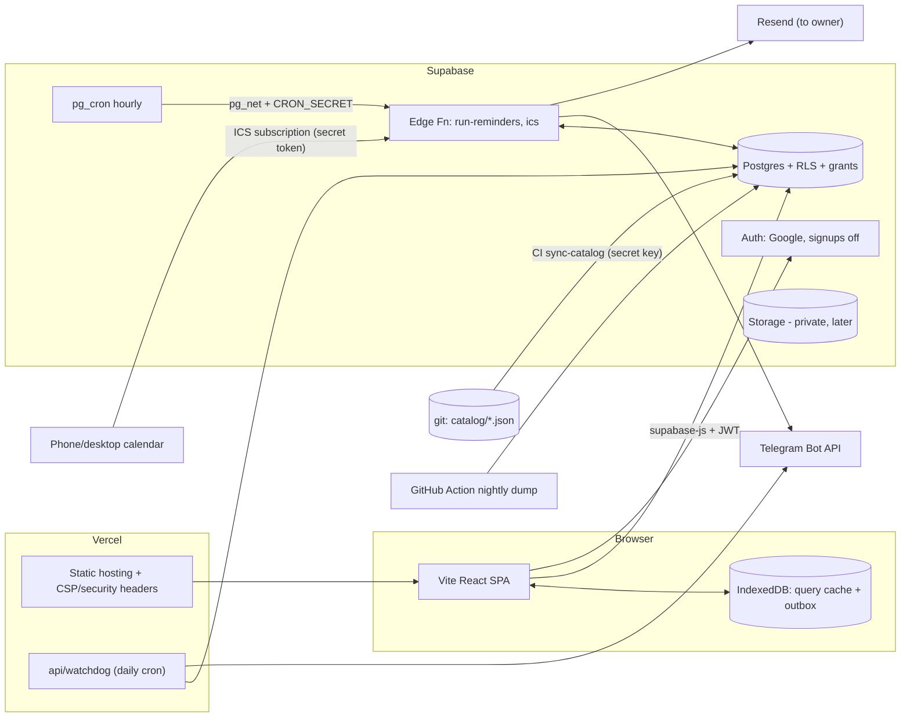

# Career Track — Architecture Blueprint v2 (supersedes "Next.js + Supabase" plan)

Status: planning artifact. No code has been written and no repository or deployment has been touched.
Date of research: 28 Sep 2026.
Audience: the implementation agent(s). Implement exactly what is specified; anything marked **OPEN** or **UNVERIFIED** must be resolved in Phase 0 before it is relied on.

Legend used throughout: **[V]** verified this session (source given) · **[I]** architectural inference · **[R]** recommendation · **†** not re-verified this session, confirm at scaffold time.

---

## 0. Evidence base and limits

**Read this session**
- Live site `https://muncareer.vercel.app/` **[V]**: client-rendered SPA (page body is empty without JS, with a "needs JavaScript" notice); sidebar "Scholarship OS · MSc 2027 · Bangladesh"; five views (Overview, Scholarships, Application Pipeline, Documents, Profile Fit) with number-key shortcuts 1–5; footer "Dataset snapshot 26 Sep 2026"; "Reset local progress" with a modal stating that scholarship, dossier, IELTS and referee progress lives *in this browser*; a theme-toggle glyph in the header.
- Previous plan (in this conversation) and `Claude.md` (role/format).

**Could not read**
- `github.com/iam-ajmunna/career-track` — GitHub returned `ROBOTS_DISALLOWED` to automated fetch **[V]**. Everything below about repo internals (`src/data.js`, positional keys like `sch-kaust-0`, localStorage key `scholarship-progress`, Vite vs vanilla) comes only from the old plan and the live site → **UNVERIFIED**. Phase 0 exists to close this gap.

**Consequence:** decisions that depend on repo internals are written as rules with a stated fallback, not as facts.

---

## 1. Executive Architecture Summary

Career Track becomes a **private, single-owner, offline-tolerant web app** whose durable state lives in Postgres, whose scholarship facts are **versioned content in git**, and whose deadline logic is a **pure, heavily-tested TypeScript domain package** shared by the browser and the reminder job.

| Concern | Decision |
|---|---|
| Frontend | **Vite + React + TypeScript SPA**, static on Vercel. *Not* Next.js (ADR-1). |
| Backend | **Supabase**: Postgres + RLS, Auth (Google), Cron, Edge Functions, Storage (later). No custom REST API. |
| Scholarship facts | **`catalog/*.json` in git** → CI projects into Postgres (ADR-2). Deadline changes are PRs. |
| User state | Postgres, owner-scoped rows with stable action keys. localStorage is never authoritative. |
| Time | UTC instant + IANA zone + published wall-clock + precision flag (ADR-7). |
| Reminders | `pg_cron` (hourly) → Edge Function → **Telegram** (+ email fallback) + **ICS calendar feed**; Vercel daily cron is an independent **watchdog** (ADR-4/5). |
| Environments | Two Supabase projects (dev/preview, prod) + local Supabase CLI. |
| Safety | Frozen baseline + legacy-progress export **before anything else**; nightly data dump; RLS and grant tests in CI. |

The product goal stays the same as the old plan: **persistence + deadline awareness + application execution**. What changes is *how safely* and *how simply* we get there.

---

## 2. Verdict on the previous plan

### Kept
DB as source of truth · stable action identifiers · `main` stays personal / `version-2` stays public · timezone-aware deadline instants · urgency bands (text + shape, not colour alone) · idempotent notifications · phased rollout with production untouched until acceptance passes · single-user private access · no scraping/AI in v1 · optimistic UI with explicit failure state.

### Changed (explicit reversals per Claude.md §28)

| # | Previous decision | Why circumstances differ | New recommendation | Migration impact |
|---|---|---|---|---|
| R1 | Next.js | Private, login-gated, one user: SSR/RSC buy nothing; add server/client boundary, framework upgrade churn, Vercel coupling **[I]** | Vite + React SPA | None (nothing built yet). If current site is already Vite/React, this *reduces* work. |
| R2 | "Vercel Cron + Resend, checks several times per day, 6h/24h thresholds" | Vercel **Hobby cron runs at most once per day**, fires anywhere inside the scheduled hour, UTC only; sub-daily expressions fail deploy **[V]** [vercel.com/docs/cron-jobs/usage-and-pricing](https://vercel.com/docs/cron-jobs/usage-and-pricing), [crontap.com](https://crontap.com/blog/vercel-cron-hourly-limit-and-how-to-beat-it). A 6-hour warning cannot be honoured. | Supabase Cron (`pg_cron` + `pg_net` → Edge Function) as scheduler; Vercel daily cron only as watchdog | New `supabase/functions/run-reminders`; no Vercel cron for reminders |
| R3 | Resend email as the alert channel | `muncareer.vercel.app` is a Vercel-owned domain — you cannot add DNS records to verify it **[I]**; Resend only sends from `onboarding@resend.dev` until a domain is verified **[V]** ([docs.rwsdk.com](https://docs.rwsdk.com/guides/email/sending-email/)) and free tier is 100/day, 3,000/mo, one domain **[V]** ([resend.com](https://resend.com/docs/knowledge-base/account-quotas-and-limits)). Email is also the slowest channel to notice. | **Telegram bot as primary push**, email as fallback (to your own address), **ICS calendar feed** as third independent channel | Add `reminder_prefs`, Telegram bot setup runbook |
| R4 | Scholarship master data moves into DB and becomes editable source of truth | Deadlines/eligibility are *facts with provenance*. Git gives review, blame, rollback, and the old plan's own rule "never auto-overwrite deadlines" for free **[R]** | Catalog authored in git, projected to DB by CI (read-only to the app) | New `catalog/` + sync script |
| R5 | Deadline lives on the scholarship | Scholarships recur yearly; deadlines, requirements and checklists are **per cycle** **[I]** | `cycle` entity ("2027 intake") owns deadline + actions | Schema |
| R6 | Status list includes "Waiting for referee / Waiting for document" | Those are *derived* from blockers. Storing them creates contradictions (status says "waiting for referee", referee row says "received") **[I]** | Stored status: `not_started, preparing, ready, submitted, skipped, withdrawn`. `closed`, `waiting_on`, `at_risk` are **computed** | Domain package |
| R7 | 13 tables incl. `users`, `profile`, `deadlines`, `notifications` | `users` duplicates `auth.users`; deadline is not its own entity; catalog vs state were mixed | 5 catalog + 11 state tables, every state row `owner_id`-scoped (§10) | Schema |
| R8 | Import existing progress at Phase 10 | Progress currently exists **only** in browsers; one cleared profile or wrong origin = permanent loss. Import needs a mapping built from the *exact* legacy checklist order | **Phase 0**: freeze baseline tag, export localStorage from every origin used, build `legacy-key-map` | Phase order |
| R9 | Passport "file uploaded: yes" | Third-party free-tier storage of identity documents is disproportionate risk for near-zero benefit **[R]** | Identity docs: **metadata only** (expiry date, status). LORs may be confidential — store only what you legitimately hold | Documents spec |
| R10 | Realtime not discussed / implied heavy sync | One user, ≤ few writes per minute | No Realtime. Refetch on focus + per-row last-write-wins | Simpler |

### Added (was missing)
Free-tier **project pausing** and no backups · cron **dead-man's switch** · Supabase **Data API explicit-grants change (enforced on existing projects 30 Oct 2026)** · cron endpoint auth (docs' example uses the public key) · date-only deadlines / unknown timezone handling · internal target date vs official deadline · **lead-time-aware "at risk"** · Bangladesh-specific connectivity → offline outbox is Phase 6, not "later" · client clock-skew detection · RLS/grant test suite · visual-parity gate for "preserve the design" · ICS feed.

---

## 3. Current-State Assessment

| | Assessment |
|---|---|
| **Existing** | Polished single-page dashboard; five views; keyboard nav; light/dark toggle (inferred); curated scholarship dataset with snapshot date; fit analysis; dossier checklist; referee & IELTS tracking; localStorage progress. |
| **Strong — preserve** | Visual language and information density; scholarship strategy content; the "Scholarship OS" mental model; keyboard-first navigation; dataset-snapshot honesty (`26 Sep 2026`). |
| **Weak** | State is per-browser-per-origin; positional checklist keys **[UNVERIFIED]**; no time model beyond dates **[UNVERIFIED]**; no auth; reset button is destructive with no undo. |
| **Missing** | Persistence, auth, exact-time deadlines, countdown, blockers/at-risk, reminders, referee×scholarship mapping, activity history, backups, tests, environments. |
| **Blocks future work** | Hard-coded data + positional IDs make any checklist edit corrupt history; no place for per-cycle facts; `version-2` cannot reuse anything until domain logic is separated from UI. |

---

## 4. Requirements Interpretation

### Functional
1. Sign in privately; nobody else can read or write.
2. Every checklist tick, document/referee status, note, and application status persists across browsers/devices/deploys.
3. Hero countdown to the next *actionable* deadline; compact timers for all others; correct across DST and timezones.
4. Per-application readiness, blockers, and **at-risk** (a lead-time task not started in time).
5. Documents as a dossier with a workflow status and a *documents × applications* matrix.
6. Referee manager with a *referees × applications* request matrix.
7. Reminders: Telegram + email fallback + ICS feed; never duplicated; never silently absent.
8. Activity history with recoverability.
9. One-time import of legacy browser progress with a dry-run diff.
10. Export everything as JSON at any time.

### Non-functional
| Area | Target |
|---|---|
| Scale | 1 owner · ~10–20 applications · ~300 checklist rows · < 2k writes/month |
| Latency | Optimistic feedback < 100 ms; state snapshot < 1.5 s p95 on Bangladeshi mobile 4G; time-to-first-paint from cache < 1 s |
| Availability | App usable read-only offline; writes queue and sync |
| Correctness | Countdown correct to ±1 s of server time; zero duplicate reminders; zero silent save failures |
| Cost | $0 by default; explicit decision on $25/mo Supabase Pro (ADR-10) |
| Accessibility | WCAG 2.2 AA; full keyboard operation; reduced-motion respected |
| Browsers | Latest Chrome/Edge/Firefox/Safari + iOS Safari |

### Implicit
- Deadlines change and recur → provenance (`source_url`, `verified_on`) is mandatory data.
- Application season has *hard, near deadlines* → **cutover risk is the dominant risk** (§20).
- This is the seed of `version-2`: keep `owner_id` on all state and keep domain code UI-free so it can be reused.

---

## 5. Architectural Decisions (ADRs)

**ADR-1 — SPA (Vite) instead of Next.js**
Context: private single-user dashboard. Alternatives: Next.js App Router; Astro; keep vanilla JS. Trade-offs: SPA loses SSR/SEO (irrelevant behind login) and gains simpler mental model, no server-component boundary, host portability. Vite currently ships as Vite 8 on Rolldown with Node ≥ 20.19 / 22.12 **[V-partial]** (seen in ecosystem changelogs; pin exact version at scaffold†). Recommendation: **Vite + React 19 + TS**. Revisit if: public multi-user `version-2` needs SEO/landing pages.

**ADR-2 — Catalog as code, state in DB**
Context: facts (deadlines, requirements, checklist definitions) vs user progress. Alternatives: everything in DB with admin UI; everything bundled JSON. Trade-offs: git = review + history + no admin UI to build; cost = editing a deadline needs a commit (acceptable for one technical user). UI still reads catalog **from DB** (one read path, cacheable, offline-persisted). Recommendation: git authoring → CI `sync-catalog` → `catalog_*` tables, idempotent, guarded by Zod schema. A deadline change emits an activity + alert. Revisit if: non-technical editors appear.

**ADR-3 — supabase-js direct with RLS; no custom API**
Context: single owner, simple CRUD. Alternatives: Express/Hono API; tRPC; Next server actions. Trade-offs: fewer moving parts and no server to run; RLS becomes the *only* authorization layer, so it must be tested (§17). Atomic multi-row operations use Postgres functions (RPC). Recommendation: direct client + `security invoker` RPCs. Revisit if: third-party integrations need server-side secrets on user action.

**ADR-4 — Scheduler = Supabase Cron; Vercel cron = watchdog**
Context: need sub-daily checks (Hobby forbids). Supabase Cron is `pg_cron`, supports sub-minute jobs, targets SQL/Edge Functions/HTTP; guidance: ≤ 8 concurrent jobs, ≤ 10 min each **[V]** ([supabase.com/docs/guides/cron](https://supabase.com/docs/guides/cron)); invoking Edge Functions via `pg_net` + Vault is the documented pattern **[V]** ([schedule-functions](https://supabase.com/docs/guides/functions/schedule-functions)). Risk: if the Supabase project is paused, the scheduler dies *with* the thing it protects. Mitigation: independent **daily Vercel cron** (allowed on Hobby) that (a) pings the DB (keep-alive), (b) checks `job_run` freshness, (c) sends a Telegram alert directly if the DB is unreachable or the job is stale. Reminder handler is idempotent so both schedulers may run it. Revisit if: Pro plan (no pausing).

**ADR-5 — Notification channels**
Telegram Bot API (official, free, no domain needed, phone push)† · email via Resend to owner address (fallback) · ICS subscription feed served by an Edge Function with a secret token (phone calendars raise native alarms *even if every server we run is down*) · Web Push deferred (iOS requires an installed PWA†). Recommendation: implement Telegram + ICS first, email second.

**ADR-6 — Auth**
Supabase Auth with Google OAuth. Sign in once to create the owner, then **disable "Allow new users to sign up"** — when off, only existing users can sign in **[V]** ([docs](https://supabase.com/docs/guides/auth/general-configuration)). Defence in depth: RLS `owner_id = (select auth.uid())` and grants only to `authenticated`, none to `anon`. Do not rely on an email allow-list in client code. Revisit if: multi-user.

**ADR-7 — Time model**
Each cycle stores: `deadline_wall` (text, as published, e.g. `2026-10-20 16:00`), `deadline_tz` (IANA, e.g. `Europe/London`), `deadline_at` (timestamptz, computed **in Postgres** via `AT TIME ZONE` at sync time), `deadline_precision` ∈ {`exact`, `date_only_end_of_day`, `tz_assumed`}, `deadline_source_url`, `deadline_verified_on`. Countdown is pure arithmetic on `deadline_at`; display uses `Intl.DateTimeFormat` with explicit `timeZone`. **No date library and no Temporal dependency**: Temporal is at TC39 Stage 4 but Safari stable lacked it as of the sources checked **[V]** ([web-platform-dx](https://web-platform-dx.github.io/web-features-explorer/features/temporal)); we don't need it. Sync rejects wall-clock times that are ambiguous/non-existent in DST transitions (e.g. 01:30 on 25 Oct 2026 in London) and requires a manual `disambiguation`. Date-only deadlines default to 23:59:59 in the provider's zone, flagged `assumed`, with a visible badge and a *personal target date* earlier than official. Revisit if: recurrence rules become complex.

**ADR-8 — Derived vs stored state**
Stored: status, per-action progress, document status, referee request status. Computed in `packages/domain`: readiness %, blockers, at-risk, urgency band, hero selection, closed, waiting_on. Never persist a computed value.

**ADR-9 — Sync & offline**
Server is truth. TanStack Query cache persisted to IndexedDB for instant paint/offline read; mutations queue when offline (persisted outbox) and resume; per-row last-write-wins; free-text fields use `updated_at` precondition (409-style toast on stale). IndexedDB may be evicted by browsers (notably Safari after idle periods†) → cache is best-effort, never authoritative. Wipe on sign-out.

**ADR-10 — Plan tier and backups**
Supabase free tier: **auto-pause after 7 days of inactivity, no automatic backups/PITR**, 2 active projects, 500 MB DB, 1 GB storage, 500k Edge invocations/mo **[V]** ([supabase.com/docs/guides/platform/free-project-pausing](https://supabase.com/docs/guides/platform/free-project-pausing), [jetadmin](https://www.jetadmin.io/blog/supabase-pricing-2026-guide-to-plans-limits-and-real-world-costs/)). Recommendation: start free **plus** (a) nightly `pg_dump` data export via GitHub Action, (b) in-app JSON export, (c) daily watchdog keep-alive. **Decision for the owner:** if losing a week of season progress would cost more than $25/mo, use Pro for the season (removes pausing, adds backups **[V]**). Revisit trigger: first pause event or first restore drill failure.

**ADR-11 — Documents storage policy**
Phase 1–9: status/metadata only. Files (CV, transcript, SOP drafts, TRF) in a **private** Storage bucket with 60-second signed URLs in a later phase. Never store passport/national-ID images. Do not store confidential LORs you are not entitled to hold.

**ADR-12 — No component library initially**
Modal via native `<dialog>`; tabs/nav via semantic HTML; progress via `<progress>`/CSS. Add Radix or Base UI only when a widget (combobox, popover) exceeds native capability; check maintenance activity at that time†.

---

## 6. Proposed System Architecture



| Layer | Choice | Notes |
|---|---|---|
| Frontend | Vite SPA on Vercel | Static; CSP via `vercel.json` headers |
| Backend | Supabase Postgres + Edge Functions | Region: nearest to Bangladesh (Singapore or Mumbai†) — confirm in dashboard at project creation; **cannot be changed later without migration** |
| Auth | Supabase Auth + Google | Signups disabled after owner exists |
| AI | None in v1 | Explicit non-goal |
| Real-time | None | Refetch on focus |
| Storage | Later phase | Private bucket |
| Infra | Vercel Hobby (personal, non-commercial **[V]**) | `version-2` as a public product would need a different plan |

Sync / async / real-time separation
- **Synchronous:** all user edits (RPC/upsert).
- **Asynchronous:** catalog sync (CI), reminders (cron), ICS render, nightly dump, watchdog.
- **Real-time:** none.

---

## 7. Frontend Architecture

**Routes** (auth gate at layout route)
```
/login
/                 Today (Overview)
/scholarships     catalog + fit list
/scholarships/:slug   application workspace
/pipeline         timeline + status view
/dossier/:tab?    documents | referees | tests
/profile          profile fit
/settings         reminders, timezone, export/import, system health
```
Keyboard: keep `1–5` view switching; `/` focuses search; `?` shows shortcuts.

**Feature modules:** `today`, `scholarships`, `pipeline`, `dossier`, `profile`, `settings`, `auth`, `sync`. Shared: `ui`, `lib` (supabase client, query client, clock).

**State architecture**
- Server state: **TanStack Query**† (persist plugin + paused-mutation resume for the outbox).
- UI state: `useState` + URL search params. **No Redux/Zustand** (justified: nothing global besides the query cache and clock).
- Domain computations: pure functions from `packages/domain`, memoised per render on `(state, minuteBucket)`.

**Data fetching**
- One RPC `get_snapshot()` (security invoker) returns *all* owner state + catalog version in a single round trip; catalog rows cached with long `staleTime` keyed by `catalog_version`.
- Mutations: table upserts on natural keys, optimistic update → rollback on error → invalidate on settle. Each mutation surfaces a **Saved / Saving / Failed-Retry** chip; failures never auto-dismiss.

**Clock architecture**
- One shared clock store (`useSyncExternalStore`). Hero subscribes at 1 s; timer cards at 30–60 s; everything else at minute buckets. Ticker paused when `document.hidden`; on `visibilitychange` recompute immediately from `Date.now()` (no accumulated drift).
- **Skew check:** compare `Date` header of Supabase responses to local clock; if |skew| > 60 s show a non-blocking "Your device clock is off by N min" notice and compute countdown against the server-corrected offset.

**Design system**
- Extract tokens from the existing stylesheet in Phase 0 into CSS custom properties: type scale, 4-pt spacing, radii, elevation, semantic colours (surface, text, border, accent, and *urgency* tokens), motion durations. Dark/light via `prefers-color-scheme` + explicit toggle.
- Primitives (≈ 12, no more): `Button`, `IconButton`, `StatusBadge` (icon + text + shape), `Progress`, `CheckRow`, `SegmentedStatus`, `Dialog`, `Toast`, `Countdown`, `Matrix`, `EmptyState`, `Skeleton`.
- **Visual-parity gate:** Phase 0 captures Playwright screenshots (5 views × light/dark × desktop/mobile). Cutover requires parity on those baselines except intentionally changed screens.

---

## 8. UI/UX Specification

### 8.1 Today (Overview) — "What must I do next, and what is at risk?"
- **Primary actions:** open hero application; tick a blocker inline; change target date; open a timer card.
- **Information hierarchy:** (1) Hero: name, `DD:HH:MM:SS`, official time in provider zone **and** in Asia/Dhaka, urgency label, readiness, top-3 blockers → (2) *At risk* strip → (3) Today list (≤ 5, algorithm §9.5) → (4) Upcoming timers → (5) summary tiles (dossier x/y, referees, applications by state).
- **Layout:** desktop 12-col (hero 8 / side rail 4 with at-risk + today); laptop same; tablet single column with rail below hero; mobile single column, timers as a vertical list (no horizontal carousels).
- **Components:** `Countdown`, `StatusBadge`, `Progress`, `CheckRow`, timer card, tile.
- **Interactions:** ticking a blocker updates readiness immediately (optimistic) and may change the hero's blockers list; submitting an application removes it from hero selection instantly.
- **Loading:** paint from persisted cache; skeleton reserves hero height (no layout shift); small "Syncing…" indicator.
- **Empty:** no applications → "Add scholarships from the catalog"; all submitted/closed → "Nothing actionable" + next cycle opens date.
- **Error:** inline save chip with Retry; offline banner "Offline — N changes queued"; expired session → re-auth dialog that preserves the outbox; stale reminder job (> 2 h) → banner.
- **Responsive/A11y:** countdown is `role="timer"` with `aria-live="off"`; a visually-hidden element announces politely only at urgency-band changes and on minute boundaries when < 24 h; reduced motion disables digit animation; urgency conveyed by **label + icon + border style**, not colour alone.

### 8.2 Scholarship workspace (`/scholarships/:slug`)
- **Purpose:** run one application end to end.
- **Actions:** change status (only valid transitions offered), tick tasks, set target-submit date, mark referee request state, attach documents used, write notes, open official/apply links.
- **Hierarchy:** sticky header (name, status, live countdown, readiness) → **Blockers** → Tasks (grouped: Research / Documents / Referees / Tests / Submit) → Documents needed (status from dossier) → Referees (request status) → Sources (official URL, `verified_on`, stale badge if > 14 days) → Notes.
- **Loading/Empty/Error:** as 8.1; notes save on blur with conflict toast if stale.
- **A11y:** tasks are a real checkbox list; status control is a labelled radiogroup; `late-start` tasks carry text "Should have started by <date>".

### 8.3 Pipeline
- **Purpose:** see the season as time. **Default view:** vertical timeline grouped by month; each application shows a *start-by → target → official deadline* bar; toggle to **status columns**. Status changes via menu (no drag-and-drop: complexity unjustified for ~15 items; keyboard-friendly).
- **Mobile:** timeline only.

### 8.4 Dossier
- Tabs: **Documents · Referees · Tests**.
- **Documents:** row = document (+ variant), status stepper `Not started → In progress → Draft → Final`, optional `expires_on`, version label. **Matrix toggle:** documents × applications ("needed / used / missing").
- **Referees:** cards + referee × application matrix; request states `Not asked → Asked → Agreed → Submitted | Declined`, with `asked_at`/`due_at` and an "overdue chase" flag when `asked_at` > 10 days without agreement (threshold configurable).
- **Tests (IELTS etc.):** target, booked date, test date, result; shows which applications it gates.
- **Empty/Error/A11y:** as above; matrices are real `<table>`s with headers; on mobile matrices scroll inside their own container.

### 8.5 Profile Fit
Re-home existing content; user-editable fields stored in `profile.data` (Zod-validated). Lowest-priority screen; parity only.

### 8.6 Settings / System
Timezone; reminder thresholds; channel toggles; **Send test message** per channel; ICS URL (copy / rotate); **Export JSON**; **Import legacy progress** (dry-run diff first); last cron run / last catalog sync / catalog version; sign out; **Danger zone** replaces "Reset local progress": requires typing the word, writes a full export first, and is recorded in the activity log.

---

## 9. Domain Model and Rules (`packages/domain`, pure TS, no I/O)

### 9.1 Application status machine
```
not_started → preparing → ready → submitted
      ↘ skipped ↔ (any pre-submit)      withdrawn (post-submit only)
```
`closed` is **computed**: `now > deadline_at && status ∉ {submitted, withdrawn}`.

### 9.2 Effective time
- `official = cycle.deadline_at`; `target = application.target_submit_at ?? official − default_buffer` (default 3 days, per-cycle override).
- Hero countdown shows official deadline; *target* is shown beneath it and drives the "Today" list.

### 9.3 Readiness, blockers, at-risk
- `required = actions where required && state ≠ n/a`; `readiness = done(required) / |required|`. Documents/referees count as done only at `final` / `submitted`.
- `blockers = required && not done`, ordered by `lead_days` desc then `order_hint`.
- `atRisk(action) = not done && now > official − action.lead_days` (e.g. referee letter lead 14 d, English test booking lead 21 d). This is the single most decision-relevant computation; unit-test it heavily.

### 9.4 Urgency bands (table-driven; boundaries inclusive-lower)
| Remaining | Band | Label |
|---|---|---|
| > 30 d | `normal` | — |
| 14–30 d | `attention` | ATTENTION |
| 7–14 d | `high` | HIGH |
| 3–7 d | `urgent` | URGENT |
| 24–72 h | `critical` | CRITICAL |
| < 24 h | `final` | FINAL HOURS |
| ≤ 0 | `closed` | CLOSED |

### 9.5 Hero and Today selection
- **Hero:** among applications with `status ∈ {not_started, preparing, ready}` and `deadline_at > now`, choose the one with the earliest `deadline_at`; tie-break by lower readiness. Skipped/submitted/closed never qualify.
- **Today list (≤ 5):** (1) at-risk actions, (2) hero blockers by lead time, (3) blockers of next two deadlines, (4) overdue referee chases.

### 9.5b Mini-timer precision
`≥ 3 d`: "22d 04h"; `< 3 d`: "2d 07h 12m"; `< 24 h`: "07h 12m 30s" (seconds only when hero-eligible).

### 9.6 Reminder scheduling (`computeDue(now, state, log, prefs)`)
- Thresholds (hours before official deadline), default `[720, 336, 168, 72, 24, 6]`.
- Eligible: status in `{not_started, preparing, ready}`, deadline in future.
- Per application, find the **most urgent crossed threshold not yet logged**; send only that one and mark older unsent thresholds `superseded` (prevents bursts after an outage).
- Content: time remaining (both zones), readiness, top-3 blockers, at-risk items, link. If `readiness = 100%` message becomes "Ready to submit".
- Quiet hours (default 23:00–07:00 Asia/Dhaka) suppress thresholds > 24 h; ≤ 24 h ignores quiet hours (configurable).
- Extra event kinds: `deadline_changed` (catalog sync), `referee_overdue`, `verification_stale`.

---

## 10. Data Architecture

### 10.1 Catalog (git-authored, read-only to the app; RLS: `select` for `authenticated`)
| Table | Purpose / key fields |
|---|---|
| `catalog_scholarship` | `slug` (PK, immutable), name, provider, country, official_url, funding_summary, fit_category, notes |
| `catalog_cycle` | `id` (`kaust-2027`), scholarship_slug, label, opens_at, `deadline_wall`, `deadline_tz`, `deadline_at`, `deadline_precision`, `deadline_source_url`, `deadline_verified_on`, referees_required, default_buffer_days |
| `catalog_action` | `key` (PK, e.g. `kaust-2027:sop`, **immutable**), cycle_id, title, kind (`task/document/referee/test/submit`), required, `lead_days`, order_hint, doc_type_key?, group |
| `catalog_action_alias` | `legacy_key` → `action_key` (e.g. `sch-kaust-3`); used by import and never deleted |
| `catalog_document_type` | key, title, variants, sensitivity (`normal/identity`) |

### 10.2 State (all rows: `owner_id uuid not null default auth.uid()`; RLS `owner_id = (select auth.uid())` for all verbs)
| Table | Key fields | Source of truth for |
|---|---|---|
| `application` | id, cycle_id, status, target_submit_at, submitted_at, notes, updated_at; **unique(owner_id, cycle_id)** | status/notes |
| `action_progress` | **PK(application_id, action_key)**, state (`todo/doing/done/na`), done_at, note, updated_at | checklist |
| `document` | id, doc_type_key, variant, status, version_label, expires_on, file_path?, meta jsonb | dossier |
| `document_use` | application_id, document_id | "used for" |
| `referee` | id, name, relationship, email?, notes | referees |
| `referee_request` | id, referee_id, application_id, status, asked_at, due_at, submitted_at | LOR workflow |
| `profile` | owner_id PK, data jsonb | profile fit inputs |
| `reminder_prefs` | owner_id PK, timezone, thresholds int[], quiet_hours, channels jsonb, telegram_chat_id, notify_email, ics_token_hash | reminders |
| `notification_log` | id, application_id, kind, threshold_hours, channel, status (`claimed/sent/failed/superseded`), attempts, sent_at, error; **unique(application_id, kind, threshold_hours, channel)** | idempotency |
| `job_run` | job_name, started_at, finished_at, status, stats jsonb | dead-man's switch |
| `activity_log` | id, at, entity, entity_id, action, before jsonb, after jsonb, source | audit/undo (trigger-populated) |

Notes: tests such as IELTS are `document` rows with `kind='test'` metadata (no extra table). Timestamps `timestamptz` everywhere. `updated_at` via trigger.

### 10.3 Grants and RLS (mandatory pattern)
Supabase **stops auto-exposing new `public` tables to the Data API**: default for new projects since 30 May 2026 and **enforced on all existing projects on 30 Oct 2026**; without an explicit `GRANT`, PostgREST rejects the query before RLS runs **[V]** ([changelog](https://supabase.com/changelog/45329-breaking-change-tables-not-exposed-to-data-and-graphql-api-automatically)). Therefore every migration that creates a table must, in the same file: `enable row level security` → policies → **explicit grants to `authenticated` only** (never `anon`). Catalog tables: `select` only. Prefer `security_invoker` for any view†. Client uses the **publishable** key; the **secret** key exists only in CI and Edge secrets (never `VITE_`-prefixed).

### 10.4 Data ownership, sync, retention
| Concern | Rule |
|---|---|
| Catalog | git is truth; DB is a projection; each sync writes `catalog_version` (git SHA) |
| Conflicts | per-row last-write-wins; free-text uses `updated_at` precondition |
| Retention | `activity_log` and `notification_log` 24 months; `job_run` 90 days |
| Backups | nightly data dump + in-app export; quarterly restore drill |
| Legacy import | merge = **union of "done"**; never downgrade or delete; unmapped keys reported, never dropped |

---

## 11. Backend / API Architecture

- **No REST layer.** supabase-js against tables + RPC.
- **RPCs (security invoker):** `get_snapshot()`, `set_application_status(app_id, to)` (enforces the state machine server-side), `import_legacy(payload jsonb, dry_run bool)` (returns diff), `export_all()`.
- **Edge Function `run-reminders`:** verify `CRON_SECRET` header (**not** the publishable key — the documented example invokes with the publishable key, which is public in any client bundle **[V]**); write `job_run`; call `domain.computeDue`; claim-then-send; per-channel timeout 10 s, 2 retries with backoff; fallback to email on Telegram failure.
- **Edge Function `ics`:** serves `text/calendar` for the owner keyed by secret token (stored hashed); contains deadline events (exact `UTC` instants) with `VALARM`s at 7 d / 3 d / 24 h / 3 h; token rotatable.
- **Vercel `api/watchdog`:** daily; keep-alive query; alerts via Telegram if DB unreachable or `job_run` stale (> 3 h).
- **CI `sync-catalog`:** validates catalog with Zod → computes `deadline_at` in Postgres → upserts → emits `deadline_changed` events. Runs on merge to the deploy branch, using the secret key from GitHub Secrets.
- **Cron:** `pg_cron` hourly `select net.http_post(...)` to `run-reminders`, secrets from Vault (pattern **[V]** in Supabase docs).

---

## 12. Integrations

| Integration | Purpose | API/SDK | Auth | Permissions | Risk | Recommendation |
|---|---|---|---|---|---|---|
| Supabase | DB/Auth/Cron/Functions | supabase-js | Google OAuth; publishable key in browser | RLS owner-only | Free-tier pause; no backups | **Use** (ADR-10) |
| Telegram Bot API† | Primary push | HTTPS `sendMessage` | Bot token (Edge secret) + your `chat_id` | Send only | Token leak; API availability | **Use** |
| Resend | Email fallback | REST/SDK | API key (Edge secret) | Send | Unverified sender → `onboarding@resend.dev` only; free 100/day, 3,000/mo, 1 domain **[V]** | **Optional** fallback |
| ICS feed | Calendar-native alarms | Own Edge Function | Secret URL token | Read-only titles/dates | Token in URL = bearer secret | **Use** — highest reliability per effort |
| Google OAuth | Sign-in | Supabase provider | OAuth client | email/profile | Redirect URI misconfig | **Use** |
| GitHub Actions | CI, catalog sync, nightly dump | Workflows | Repo secrets | Least privilege | Secrets exposure in forks | **Use** |
| Vercel | Hosting + watchdog | Git deploy | — | — | Hobby = personal use only **[V]** | **Use** |

---

## 13. Open-Source / GitHub Research

Only repositories confirmed to exist this session are listed.

| Repository | Purpose | License | Activity | Integration effort | How we use it |
|---|---|---|---|---|---|
| [supabase/supabase](https://github.com/supabase/supabase) | Platform, docs, agent skills | Apache-2.0† | Very active **[V]** (PRs dated May 2026) | Low | **Use as service.** Give the implementation agent Supabase's *agent skills* (they include the new grants step) — see the changelog reference above. |
| [citusdata/pg_cron](https://github.com/citusdata/pg_cron) | Scheduler extension under Supabase Cron | PostgreSQL-license† | Mature† | None (managed) | **Use via Supabase Cron.** |
| [OpenSourcePatents/Supabase_Keepalive](https://github.com/OpenSourcePatents/Supabase_Keepalive) | Pings projects to prevent pause | Apache-2.0 **[V]** | 3 commits, 0 stars **[V]** | Low | **Avoid** — our watchdog does this plus dead-man alerts; nothing to adopt. |
| [mdhasan2/career-command-center](https://github.com/mdhasan2/career-command-center) | Streamlit dashboard with an "attention score" (fit, urgency, status) | not checked | not checked | n/a | **Architecture reference only** for prioritisation; not adopted (different stack, reads Google Sheets). |

No existing repository was found that solves scholarship-cycle tracking with lead-time-aware risk; **build** the domain layer.

---

## 14. Library / Plugin Research

| Tool | Solves | Why useful | Alternative | Recommendation |
|---|---|---|---|---|
| React 19 + TypeScript | UI, types | Team familiarity, ecosystem | Solid/Svelte | **Foundational** |
| Vite (8.x observed; pin) | Build/dev | Fast; Node ≥ 20.19 / 22.12 | Next.js | **Foundational** |
| React Router (library mode)† | Routing | Small, stable | TanStack Router | **Foundational** |
| `@supabase/supabase-js` | DB/Auth client | Official | direct fetch | **Foundational** |
| TanStack Query† + persist plugin | Server state, optimistic, offline queue | Purpose-built for our sync model | SWR, hand-rolled | **Foundational** |
| Zod† | Catalog/import/profile validation | One schema for CI + runtime | Valibot | **Foundational** |
| Vitest† | Domain unit tests, fake clock | Vite-native | Jest | **Foundational** |
| Playwright† | E2E + visual baselines | Multi-context tests (second "device") | Cypress | **Foundational** |
| `supabase test db` (pgTAP)† | RLS/grant tests | Only reliable way to prove isolation | ad-hoc SQL | **Foundational** |
| `Intl.DateTimeFormat` | Zone display | Built-in, zero deps | dayjs/luxon/Temporal | **Use** — no date lib |
| lucide-react† | Icons | Tree-shakeable | inline SVG | **Optional** |
| Radix / Base UI | A11y primitives | Only if native fails | — | **Avoid until needed** |
| Sentry† | Frontend errors | Optional | Vercel/Supabase logs only | **Optional** |
| Redux/Zustand, date libs, CSS-in-JS, GraphQL, vector DB, queues, Kubernetes | — | Unjustified at this scale | — | **Avoid** |

**Dependency matrix**

| Dependency | Role | Required? | Client/Server | Risk | Notes |
|---|---|---|---|---|---|
| react, react-dom | UI | Yes | Client | Low | Pin majors |
| vite, TypeScript | Build | Yes | Dev | Low | Node engine constraint |
| react-router | Routing | Yes | Client | Low | |
| @supabase/supabase-js | Backend client | Yes | Client + Edge | Medium | Track Data-API changes |
| @tanstack/react-query (+persist) | State/sync | Yes | Client | Low | |
| zod | Schemas | Yes | Both | Low | |
| vitest, playwright | Test | Yes | Dev | Low | |
| Telegram/Resend | Notify | Telegram yes / Resend optional | Edge | Medium | Secrets in Edge only |

---

## 15. Build vs Integrate Decisions

| Capability | Decision |
|---|---|
| Auth, DB, scheduler, storage | **Managed** (Supabase) |
| Deadline/readiness/at-risk/reminder logic | **Build** (core differentiator; pure & tested) |
| Catalog authoring | **Build minimal** (JSON + Zod + sync script) |
| Push notifications | **Integrate** (Telegram) + **standards** (ICS) |
| Email | **Integrate** (Resend) as fallback only |
| Date/time | **Platform** (`Intl`), no library |
| UI components | **Build ~12 primitives**; native elements first |
| Scholarship scraping/verification | **Avoid in v1**; later assist-only (§20 Phase 10) |

---

## 16. Security Model

| Surface | Control |
|---|---|
| Authn | Google via Supabase; signups off after owner exists; short session refresh handled by supabase-js; sign-out clears query cache |
| Authz | RLS on every state table; catalog `select` only; grants to `authenticated` only; **pgTAP tests assert `anon` and a second test user get zero rows and cannot write** |
| Data API exposure | Explicit grants per table in the same migration (change enforced 30 Oct 2026 **[V]**) |
| Secrets | Publishable key in browser; secret key + `CRON_SECRET` + Telegram token + Resend key only in GitHub/Edge/Vercel secrets; nothing secret in `VITE_*` |
| Cron endpoint | Requires `CRON_SECRET`; idempotent regardless |
| ICS token | 256-bit random, stored hashed, rotatable, exposes only titles + instants |
| XSS | Notes rendered as text; no `dangerouslySetInnerHTML`; CSP: `default-src 'self'`, `connect-src` limited to the Supabase project origin, `frame-ancestors 'none'` |
| CSRF | No cookie-auth custom endpoints; Supabase JWT in memory/storage per SDK; watchdog endpoint checks Vercel cron header/secret |
| OAuth | Exact redirect-URL allow-list per environment |
| Files (later) | Private bucket, MIME + size allow-list (PDF/DOCX ≤ 10 MB), signed URLs 60 s, no identity documents |
| Audit | `activity_log` via triggers (cannot be forgotten by app code) |
| Supply chain | Lockfile, `npm audit` + Dependabot, no postinstall scripts from unknown packages |
| Dev tooling | If using Supabase's Claude connector or MCP for development, point it at the **dev** project only; never prod |

No AI tool execution exists in v1. If added later: read-only tools first; any mutation requires explicit per-action confirmation.

---

## 17. Performance Strategy

| Budget | Target |
|---|---|
| Initial JS (gzip) | ≤ 150 KB |
| LCP (cached / cold) | ≤ 1.0 s / ≤ 2.5 s on Slow-4G emulation |
| Optimistic feedback | < 100 ms |
| `get_snapshot` p95 | < 500 ms server-side; one round trip |
| Hero tick | 1 subscriber, no full-tree re-render |
| CLS | 0 on hero |

**Likely bottlenecks:** round-trip latency from Dhaka (→ region choice, single snapshot RPC, persisted cache); **cold start after a project pause (10–30 s reported** ([dev.to](https://dev.to/nayankyada/supabase-pricing-2026-free-tier-limits-compute-costs-when-to-upgrade-52af)) → skeleton + 15 s timeout + explicit "database waking up" state); per-second re-renders (→ isolated clock store); accidental large imports.
**Code-splitting:** route-level lazy loading for `pipeline`, `dossier`, `settings`.

---

## 18. Testing Architecture

| Level | What | Tooling |
|---|---|---|
| Unit (highest value) | Time engine, urgency, readiness, at-risk, hero selection, `computeDue` | Vitest with fake clock; fixtures: London DST end **25 Oct 2026**, US DST end **1 Nov 2026**, Asia/Dhaka (no DST), Asia/Riyadh, Asia/Dubai, America/Los_Angeles, midnight rollover, leap day, ambiguous wall times (must be rejected) |
| DB | RLS isolation, grants, state-machine RPC, unique claims, triggers | `supabase test db` |
| Contract | Catalog Zod schema; alias map completeness (every legacy key maps or is listed) | Vitest in CI |
| Integration | Sync script idempotency; `run-reminders` against local Supabase with stubbed Telegram | Vitest + CLI |
| E2E | (1) tick → reload → persisted; (2) **second browser context sees it**; (3) signed-out sees nothing; (4) offline tick queues then syncs; (5) forced 500 shows Failed-Retry; (6) legacy import dry-run then commit | Playwright |
| Visual | Baseline parity of 5 views × 2 themes × 2 viewports | Playwright screenshots |
| A11y | Axe on each route; keyboard-only walkthrough | Playwright + axe |
| Load | Not needed | — |

Skip: exhaustive component tests for trivial presentational components.

---

## 19. Repository / Module Architecture

```text
career-track/
  apps/web/                    # Vite SPA (Vercel root directory)
    src/{app,features,shared}/
    api/watchdog.ts            # Vercel function, daily cron
    vercel.json                # headers (CSP), cron
  packages/domain/             # pure TS: time, urgency, readiness, at-risk, reminders, zod schemas
  catalog/
    scholarships/*.json        # facts + cycles + actions (git = source of truth)
    legacy-key-map.json        # generated in Phase 0 from frozen commit
  supabase/
    migrations/                # tables + RLS + grants + triggers, together
    functions/{run-reminders,ics}/ and _shared/
    tests/                     # pgTAP
    config.toml  seed.sql
  scripts/{sync-catalog,export-backup}.ts
  .github/workflows/{ci,catalog-sync,nightly-backup}.yml
  docs/{ARCHITECTURE.md,AUDIT.md,RUNBOOK.md,adr/}
```
Risk to resolve in P1: consuming `packages/domain` from a Deno Edge Function (import map or build step) — verify at scaffold†.

---

## 20. Implementation Roadmap

**Interim protection (do today, independent of all phases):** put every *verified* near-term deadline into your phone calendar with alarms. The current site cannot warn you, and deadlines may fall before cutover. Keep `main` frozen except data hotfixes until cutover.

| Phase | Work | Prod impact | Exit criteria |
|---|---|---|---|
| **P0 Baseline freeze & audit** | Tag `pre-migration`; export localStorage from *every* origin/browser used; read repo; write `AUDIT.md`; build `legacy-key-map.json`; capture visual baselines; extract design tokens; verify each near-term deadline from official sources | None | Exports safely stored; mapping covers 100 % of legacy keys |
| **P1 Foundations** | Scaffold on `personal-dynamic`; CI; local Supabase; dev project; migrations with RLS+grants; pgTAP; catalog schema + sync; **domain package with time/urgency tests first** | None (preview) | CI green; RLS tests prove isolation |
| **P2 Persistence vertical slice** | Google sign-in; one scholarship's checklist end-to-end; optimistic + failure UX; two-context E2E | Preview | Old plan's persistence acceptance tests pass on this slice |
| **P3 Shell + parity** | Port five views onto new shell/design tokens; scholarship workspace | Preview | Visual-parity gate passes |
| **P4 Deadline engine UI** | Hero, timers, urgency, blockers, at-risk, Today list, clock skew notice | Preview | DST/midnight/closure fixtures pass |
| **P5 Dossier** | Documents, referees, tests, matrices; activity log | Preview | Matrix E2E |
| **P6 Reliability** | Persisted cache + offline outbox; export JSON; nightly dump; restore drill | Preview | Offline E2E; restore drill succeeds |
| **— Cutover gate A —** | Prod Supabase project; migrations; catalog sync; **real deadlines verified**; legacy import (dry-run → commit); device/browser UAT | Prod data | Full acceptance table (§21) green |
| **P7 Cutover** | Merge to `main`; verify `muncareer.vercel.app`; keep previous Vercel deployment for rollback† | **Production** | 48 h clean observation |
| **P8 Reminders** | pg_cron → Edge → Telegram/email; ICS; watchdog; `job_run`; settings UI | Production | No duplicates in 7-day soak; dead-man alert proven by deliberately stopping the job |
| **P9 Hardening** | CSP tighten, dependency audit, observability polish, runbook | Production | Security checklist |
| **P10 Later** | File uploads (private bucket), Web Push, assist-only catalog freshness check (human confirms every change) | Production | — |

If a hard deadline lands before P8, rely on the interim calendar alarms; do **not** rush reminders into cutover.

---

## 21. Acceptance Criteria (superset of old plan)

| Test | Required |
|---|---|
| Tick → refresh / close browser / second computer / deploy / clear localStorage | Persisted everywhere |
| Reorder or rename a checklist item in catalog | Progress preserved (stable keys + alias) |
| Countdown across midnight, DST (London 25 Oct 2026), Dhaka display | Correct |
| Date-only deadline | Shows "assumed 23:59 <zone>" badge |
| Deadline passes / application submitted | Closed / leaves hero automatically |
| Network failure on save | Visible failed state with Retry; never silently lost |
| Offline tick | Queued, syncs on reconnect, survives reload |
| Signed out / second user / `anon` | Zero rows, zero writes (pgTAP + E2E) |
| Duplicate cron invocation | One notification |
| Outage of N hours then recovery | One (most urgent) notification, others `superseded` |
| Job stopped deliberately | Watchdog Telegram alert within 24 h; in-app banner within 2 h |
| Catalog deadline changed | `deadline_changed` activity + alert; no silent overwrite |
| Legacy import twice | No change second time |
| Restore drill from backup | Data recovered |
| Device clock off by > 60 s | Warning shown; countdown server-corrected |

---

## 22. Engineering Task Breakdown — Phase 0 (next phase)

**P0-1 Freeze baseline**
Objective: immutable recovery point. Affects: git only. Dependencies: none. Acceptance: annotated tag `pre-migration` on current `main`; Vercel deployment for that commit noted as rollback target. Tests: tag resolves; deployment URL loads.

**P0-2 Export legacy progress from every origin**
Objective: capture localStorage from each origin/browser/profile you have used (production URL, previews, localhost). Dependencies: owner action. Acceptance: one JSON file per origin stored in two places outside the repo; record which is the "richest". Tests: JSON parses; key counts recorded in `AUDIT.md`. *(Do not commit exports to git — personal data.)*

**P0-3 Repository audit → `docs/AUDIT.md`**
Objective: replace UNVERIFIED items. Contents: framework/build tool, package manifest, file tree, where state is read/written, localStorage key inventory and shapes, checklist definitions with indexes, CSS architecture, theme mechanism, data source shape and size. Acceptance: every UNVERIFIED tag in this document is resolved or amended. Tests: n/a.

**P0-4 Legacy key map**
Objective: `catalog/legacy-key-map.json` mapping every observed legacy key → proposed stable action/document/referee key. Built from the `pre-migration` commit's data order. Acceptance: 100 % of keys in the P0-2 exports map or are explicitly flagged; naming convention `<scholarship>-<yyyy>:<slug>`. Tests: script asserts coverage against each export.

**P0-5 Visual & design baseline**
Objective: screenshots (5 views × light/dark × desktop 1440 / mobile 390) + token extraction (`docs/tokens.md`). Acceptance: reproducible Playwright script committed; tokens listed with values. Tests: script runs headless.

**P0-6 Deadline verification sheet**
Objective: for each active scholarship record official URL, deadline wall-clock, IANA zone, precision, opens date, `verified_on`. Acceptance: no deadline without a source URL; date-only ones flagged. Tests: sheet validates against the `catalog_cycle` field list in §10.1. *(Old-plan example dates such as "Commonwealth 20 Oct 16:00 BST" or "KAUST 3 Jan 2027" were illustrative and **UNVERIFIED**; treat all as unknown until sourced.)*

**Phase 1 outline (for planning only):** P1-1 scaffold + CI · P1-2 local Supabase + dev project · P1-3 migrations for §10 with RLS+grants · P1-4 pgTAP isolation suite · P1-5 catalog Zod schema + sync script · P1-6 `packages/domain` time/urgency with fixtures · P1-7 auth + gate · P1-8 typed client + `get_snapshot`.

---

## 23. Edge Cases / Failure Modes

| Failure | Handling |
|---|---|
| Supabase free project paused (7 days idle) | Daily watchdog keep-alive; UI "database waking" state with 15 s timeout; runbook for restore; consider Pro |
| `pg_cron`/Edge not running | `job_run` staleness banner (> 2 h) + watchdog Telegram alert |
| Duplicate/parallel cron | Unique key claim; `ON CONFLICT DO NOTHING` |
| Send OK, log write fails | At-least-once accepted (a duplicate is safer than a miss) |
| Telegram token revoked/API down | Failure count → email fallback → in-app banner |
| Token expiry after sleep | Auto-refresh; on failure pause outbox, reauth dialog, resume |
| Concurrent edits (two devices) | Row LWW; notes precondition + conflict toast |
| Legacy import: wrong/stale origin | Dry-run diff before commit; union-merge only |
| Legacy import: unmapped key | Listed in report; not dropped |
| Catalog renames action | `catalog_action_alias`; keys immutable |
| Deadline changed upstream | PR-reviewed; alert + activity; hero recomputes |
| Ambiguous DST wall time | Sync rejects; requires explicit disambiguation |
| Date-only / timezone unknown | `precision` flag, badge, personal target earlier |
| Official portal closes earlier than stated | Personal target buffer + note field; user-editable buffer |
| Device clock wrong | Skew detection using server `Date` header |
| IndexedDB evicted / private mode | Falls back to network-only; no data loss (server truth) |
| Oversized notes / imports | 20 k-char cap on notes; import size cap 1 MB |
| Browser lacks Temporal | Irrelevant (not used) |
| Stale catalog view after sync | `catalog_version` mismatch → "Data updated, reload" |
| Data API grant missing on new table | CI test that every state/catalog table is reachable by `authenticated` and not by `anon` |

---

## 24. Optimization Opportunities

- One `get_snapshot()` RPC instead of ~10 selects (fewer round trips from Dhaka).
- Long `staleTime` on catalog keyed by `catalog_version`.
- Route-level code splitting; no icon/UI libraries by default.
- Isolated clock store avoids per-second app re-renders.
- ICS feed offloads alerting to platform calendars (fewer server invocations).
- Reminders run hourly, not per-minute; Edge invocations stay far below the 500k/month free cap **[V]** figure.

---

## 25. Technical Debt Risks

- Sharing `packages/domain` with Deno Edge Functions may need a build step; decide early (P1).
- Catalog-in-git makes non-technical edits awkward; acceptable for one owner.
- Both free Supabase project slots consumed (prod + dev); a third project needs Pro or teardown.
- `version-2` (public) will need Vercel Pro (Hobby is non-commercial), multi-tenant RLS review, and a proper editor; keeping `owner_id` and a UI-free domain package is the forward-compat investment.
- Supabase Data API/grant behaviour is changing in 2026; keep migrations explicit.
- React/Vite major-version churn; pin and upgrade deliberately.
- Telegram dependence: keep ICS as the independent fallback.

---

## 26. Open Questions (only those that change architecture)

1. **Backups vs cost:** free tier + nightly dump + watchdog, or Supabase Pro ($25/mo) for the application season? *(Recommendation: start free, decide after the first restore drill.)*
2. **Alert channel:** is Telegram acceptable as the primary push channel? If not, the fallback order becomes ICS → email.
3. **Where is your true progress today?** Which browser/origin holds the most complete state (drives import merge in P0-2)?
4. **Any hard deadline within ~3 weeks?** If yes, the interim calendar step is urgent and P7 should be scheduled after it.

---

## NEXT IMPLEMENTATION TARGET

**Phase 0 — Baseline freeze, legacy-progress export, and repository audit.**

- **Why first:** current progress exists only in browsers and can be lost by a single cleared profile; the mapping from positional keys to stable keys can only be built from the *current* checklist order; and this blueprint's repo-dependent assumptions are still UNVERIFIED.
- **Prerequisites:** access to the repository and to each browser/origin you have used.
- **Completion criteria:** tasks P0-1 to P0-6 done — `pre-migration` tag exists; legacy exports stored outside git; `docs/AUDIT.md` resolves every UNVERIFIED item (or amends the affected decision); `legacy-key-map.json` covers 100 % of observed keys; visual baselines and design tokens captured; a sourced deadline sheet exists for every active scholarship.
- Do **not** begin Phase 1 until these are complete.

---

# 27. Addendum — 28 Sep 2026: recorded decisions and 48-hour Express Track

**This addendum supersedes "NEXT IMPLEMENTATION TARGET" above and reorders the roadmap for the first release.**

## 27.1 Decisions recorded
| Question | Answer | Effect |
|---|---|---|
| Plan tier | **Completely free** | ADR-10 fixed: free tiers + watchdog/keep-alive + nightly dump. No Supabase Pro. |
| Alert channel | **Telegram accepted** | Primary push = Telegram (built in P8, not in Express Track). |
| Where is true progress | Owner unsure | P0-2 becomes a guided manual check (see chat instructions). |
| Timing | **Hard deadline within 3 weeks; owner wants a working version in 2 days** | Express Track below. |

## 27.2 Architect's judgement on "everything in 2 days"
The full blueprint (React rewrite, normalised schema, referee/document matrices, reminders, tests, cutover) is **not** safely achievable in 48 hours. A rushed cutover on the site that protects real deadlines is the highest-risk event in this project. What *is* achievable in 48 hours is the part that fixes the actual pain: **progress that survives across browsers/devices + an exact countdown + calendar alarms**, on the **existing UI**. Everything else is deferred, not dropped.

**Express Track = persistence + auth + hero countdown + ICS alarms. No UI rewrite. No schema normalisation.**

## 27.3 Express Track — scope
**In**
1. Freeze baseline (tag) and export legacy progress (P0-1, P0-2, minimal P0-3).
2. Supabase **dev/prod-in-one** project (free), Google sign-in, signups disabled after owner exists.
3. **One table `user_state`**: `owner_id uuid pk default auth.uid()`, `state jsonb`, `rev int`, `updated_at timestamptz`. RLS owner-only; explicit `GRANT` to `authenticated` only (none to `anon`); trigger increments `rev`.
4. **Storage adapter** replacing every direct localStorage read/write in the current app: `load()`, `save(partial)`. Write-through: localStorage stays as a *cache*, Supabase is truth.
5. Sync rules: on load fetch remote; if remote `rev` > local base rev → **union-merge all "done/true" flags** (never lose a tick), last-write-wins for other fields; save is optimistic with a visible **Saved / Saving / Failed-Retry** indicator; save uses `rev` precondition to avoid stale overwrite.
6. **Legacy import**: one-time button that loads the exported JSON, shows a dry-run count, then merges (union only, idempotent).
7. **Countdown**: a static `deadlines.json` of *sourced* deadlines (`deadline_wall`, `deadline_tz`, `deadline_at` in UTC, `precision`, `source_url`, `verified_on`); hero timer + compact timers on Overview using shared time/urgency logic (P1-6 subset: time engine + urgency bands + hero selection, with DST fixtures for London 25 Oct 2026 and US 1 Nov 2026).
8. **Static `deadlines.ics`** generated at build from `deadlines.json` (UTC instants, alarms at 7 d / 3 d / 24 h / 3 h). Contains only public deadline facts — no personal data, so no secret token is needed in Express Track. Subscribe from phone calendar.
9. Deploy path: branch `personal-dynamic` → Vercel Preview → acceptance subset → merge to `main` with the `pre-migration` tag as rollback.

**Out (explicitly deferred)**: React/Vite rewrite · stable action keys and normalised schema (**temporary tech debt: positional keys remain; freeze the checklist order until P2 and do not edit checklist items**) · referee/document matrices · activity log · Telegram/email reminders and cron · file uploads · offline outbox · visual redesign · pgTAP suite beyond one isolation test.

## 27.4 Go / No-Go gates
- **Gate 1 (hour ≤ 4):** audit shows state reads/writes are centralised (or centralisable) in a small number of places. If storage access is scattered across many files or the stack cannot host a Supabase JS client, **stop** and fall back to: calendar alarms + manual export only, and proceed with the full blueprint after the deadline.
- **Gate 2 (before merge to `main`):** all five acceptance checks below pass on the Preview URL.
- **Gate 3:** if any Gate-2 check fails by the end of day 2, **do not merge**; keep `main` untouched, keep using calendar alarms. A late cutover is better than a corrupted one.

## 27.5 Express acceptance checks
| Check | Required |
|---|---|
| Tick → refresh → still ticked | Pass |
| Sign in on a second browser/device → same ticks | Pass |
| Signed-out user or a different Google account | Sees nothing, cannot write (one SQL/E2E isolation test) |
| Force a failed save (offline/blocked request) | Visible Failed-Retry state, tick not silently lost |
| Import legacy JSON twice | Second run changes nothing |
| Countdown for a London-time deadline across 25 Oct 2026 | Correct; Dhaka time shown alongside |
| ICS feed subscribed on phone | Events appear at correct UTC instant with alarms |

## 27.6 Express task list
| ID | Task | Est. | Depends on |
|---|---|---|---|
| E-0 | Calendar alarms (owner, manual) + tag `pre-migration` + export progress | 45 min | — |
| E-1 | Audit storage touch-points; Gate 1 decision | 2 h | E-0 |
| E-2 | Supabase project, Google OAuth, signups off after owner exists, `user_state` + RLS + grants + trigger | 2 h | E-1 |
| E-3 | Storage adapter + sync/merge rules + status indicator + login gate | 5 h | E-2 |
| E-4 | Legacy import (dry-run + merge) | 2 h | E-3 |
| E-5 | `deadlines.json` (sourced), time/urgency logic + tests, hero + timers | 5 h | E-1 |
| E-6 | `deadlines.ics` build step | 1.5 h | E-5 |
| E-7 | Preview UAT on 2 browsers + phone; Gate 2 | 2 h | E-3..E-6 |
| E-8 | Merge to `main`; verify prod; keep rollback | 1 h | Gate 2 |

Estimates assume the current app is small and its state access is centralisable (UNVERIFIED until E-1).

## 27.7 What Express does NOT protect you from
No server-side reminders (calendar alarms only); progress keys are still positional (do not reorder checklist items); no backups beyond manual JSON export until P6; free Supabase may pause after 7 days without use (open the site weekly until the watchdog exists). These are accepted risks for the 2-day release and are removed by P6–P8.

## 27.8 NEXT IMPLEMENTATION TARGET (replaces the earlier one)
**E-0 → E-1: baseline freeze, progress export, and storage touch-point audit (Gate 1).**
Completion: `pre-migration` tag exists; exports saved outside git; a list of every place the app reads/writes progress; explicit Go/No-Go recorded for Express Track.

## 27.9 Product requirement clarified (owner): "Progress must be visible whenever and wherever I open it"

Recorded as the **primary acceptance requirement** for the first release. It replaces open question 3 (which browser holds truth): the server copy becomes the only truth, so the browser of origin no longer matters after one import.

Implications:
1. **Any device, same state:** sign in once per device with Google; the session then persists. Every load fetches the server copy first (`get` before render of progress), with the local cache used only for instant paint and offline read.
2. **One-time import is mandatory**, otherwise the server starts empty. Export from every browser that holds ticks (E-0); the union-merge import (E-4) combines them without losing any tick.
3. **"Whenever" conflicts with free-tier pausing.** A free Supabase project pauses after 7 days of inactivity and needs manual reactivation ([docs](https://supabase.com/docs/guides/platform/free-project-pausing)); until restored, progress would *not* be visible. This risk is therefore pulled **into the Express Track**:
   - **E-2b (30–45 min):** daily keep-alive — a Vercel daily cron hitting a tiny `api/keepalive` function that performs one lightweight query. (Vercel Hobby allows daily cron, timing within the hour, UTC.) Alert-on-failure is deferred to the P8 watchdog.
   - Runbook line: if the app shows "database unavailable", open the Supabase dashboard and restore the project; data is retained.
4. **"Wherever" includes bad connectivity:** on first load without internet the app shows the last cached copy with an "Offline — showing last saved copy" banner; edits made offline are held locally and merged on reconnect (union-merge of ticks, so nothing is lost). A full persisted offline queue remains P6.
5. **Acceptance addition:** sign in on a device that has never opened the site → all previously imported progress appears within one load, with no manual step.

Added to the Express task list: **E-2b keep-alive** (depends on E-2), and acceptance row 8 above.
