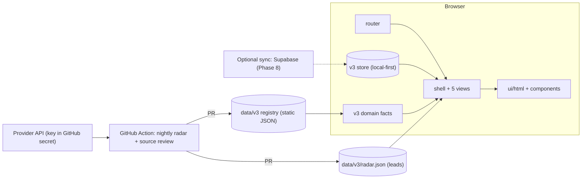

# Career Track v4 — Implementation Plan
*Make it calm, make it obvious, make it shareable.*

Status: planning artifact · Date: 20 Oct 2026 · Repo inspected: `iam-ajmunna/career-track` @ `main` (8eec65b, v0.3.2)
Companion files: `agent.md` (how an agent must work) · `coding.md` (exact tags, attributes, tokens, functions, code) · `STATUS.md` (live progress)

---

## 0. What I inspected, and how well

| Area | What I did | Confidence |
|---|---|---|
| Product docs | Read `README.md`, `docs/v3/ARCHITECTURE.md`, `PROGRESS.md`, `MIGRATION.md`, `DESIGN.md` | High |
| UI code | Read `index.html`, `src/bootstrap.js`, `src/v3/workspace.js` (controller), `src/v3/views.js` (all view templates) | High |
| Design | Read `assets/styles.css` (all tokens and components) and your screenshot | High |
| Domain/data | Read `src/v3/schema.js`, `src/v3/domain.js`, `data/v3/countries.json`; listed `data/v3`, `src`, `src/views`, `.github/workflows`, `api`, `supabase` | High / Medium |
| Deployment | Read `package.json`, `vercel.json`, `.env.example`, `supabase/project.json`, `supabase/owner-profile.json` | High |
| **Not read (agent must audit in step S0)** | `src/v3/store.js`, `src/v3/calendar.js`, legacy `src/app.js`, `src/personalized-goal*.js`, `tests/*`, `scripts/*`, `docs/UX-CONTRACT.md`, `data/v3/opportunities.json` (323 KB) | — |
| **Not executed** | I did not run the app, its 111 tests or 19 browser scenarios; those numbers come from the repo's commit message | — |

Anything below that depends on an unread file is marked **VERIFY (S0)**.

---

## 1. Diagnosis — why the site feels messy (with evidence)

| # | Problem | Evidence | Fix in v4 |
|---|---|---|---|
| D1 | **13 sidebar items** compete for attention. Several are the same thing at different zoom levels (Scholarship / Country / University Explorer; Research & Supervisors; Research & Sources). | Screenshot sidebar; `workspace.js` view list | **5 items** (Dashboard, Scholarships, Calendar, Documents, Settings). Everything else becomes a tab or section *inside* one of them (§3). |
| D2 | **Dashboard asks you to read before you can act.** Six equal-weight metric cards, a policy paragraph ("Application windows, funding and your progress are independent. Global counts include every route, including history."), then one hero. | Screenshot | One hero (the countdown you asked for), a profile card, four KPIs, your application board, a short "closing soon" list, and a matches feed. No explanatory paragraphs. |
| D3 | **Evidence is the loudest thing on screen.** Verification badges, "Checked 2026-10-16. Confirm prerequisites…", "Coverage and limitations" sit at the same level as actions. | Screenshot; `views.js` | Keep the rigour, demote it: one small freshness line in the sidebar and a "Sources" section inside each detail drawer. |
| D4 | **Country Explorer is a flat A–Z grid.** Your five-requirement tiers and "what you sacrifice" lines were built on 15 Oct but are not in the V3 view code. | `views.js` country view; `src/views/*` files exist but V3 workspace does not use them (**VERIFY S0**) | Restore tiers and sacrifice lines as the default **Scholarships** landing page (§4.2). |
| D5 | **A–Q guide accordions** (17 sections) in one scroll per scholarship. | `views.js` guide renderer | Detail **drawer** with 6 tabs; the long guide lives under "Guide" and is lazy-loaded. |
| D6 | **Visual hierarchy is flat.** Everything is monochrome with the same card weight; one accent colour (black). | `DESIGN.md`, `styles.css` | Keep the neutral base, add **one brand colour**, a real type scale, and consistent elevation (§5). |
| D7 | **Two colour pairs fail WCAG AA** (computed): `--muted #70757D` is 4.13:1 on `--surface-2` and 4.33:1 on `--bg`; warning `#8F6A12` is 4.42:1 on `--surface-2` and 4.36:1 on its soft tint. | Computed from `styles.css` values | New tokens: muted `#5B616B` (≥ 5.5:1 on all surfaces), warning `#7F5E0E` (≥ 5.0:1), success `#1B6F48`. |
| D8 | **Progress is only on one device.** README: no automatic cross-device sync; CSP `connect-src 'self'` blocks any cloud call. Supabase code and `api/keepalive.js` exist but are switched off. | README, `vercel.json` | Optional, opt-in **Sync** (Phase 8) behind Settings → Backup & sync; local-first stays the default. |
| D9 | **No "matches" discovery.** The site only shows what is already curated. | — | **Matches for you** feed from a nightly collector (§7). |
| D10 | **Personal data is in a public repository.** `supabase/owner-profile.json` contains name, university, CGPA and self-scored ratings. | File read | Phase 0: remove from git (and history), return repo to private, introduce **Demo mode** with fictional data. |
| D11 | **Performance risk:** `data/v3/opportunities.json` is ~323 KB (guide text included). If bundled, every first paint pays for it. | File listing | Split into a light **index** (lists, cards) and per-opportunity **guide** files loaded on demand (§6.4). **VERIFY S0** how `scripts/build.mjs` ships it. |

---

## 2. Product principles (decide every disagreement with these)

1. **One next action.** Every page answers one question and shows one primary button.
2. **Calm, not empty.** Generous space, short sentences, ≤ 2 lines of helper text anywhere.
3. **Facts on demand.** Evidence is one click away, never in the way.
4. **Never invent a date, fund or rule.** Unknown stays "Not confirmed" (the V3 data contract is kept as is).
5. **Your data is yours.** Local-first; cloud is opt-in; nothing personal in git; a Demo mode for sharing.
6. **Accessible by default.** WCAG 2.2 AA, keyboard-complete, status is never colour alone.

---

## 3. Information architecture

### 3.1 Sidebar: 13 → 5
| New item | Key | Absorbs (old items) |
|---|---|---|
| **Dashboard** | `1` | Overview, Application Pipeline |
| **Scholarships** | `2` | Scholarship Explorer, Country Explorer, University Explorer, Research & Supervisors |
| **Calendar** | `3` | Calendar |
| **Documents** | `4` | Documents & References |
| **Settings** | `5` | Settings, My Profile, Research & Sources, Personalized Goal, Archive & History |

**Profile lives in the top-right avatar menu** (as you asked), with links into Settings sections.

### 3.2 Routes (hash, deep-linkable)
```
#/dashboard
#/scholarships                         tab "By country"      (default)
#/scholarships/list                    tab "My list"
#/scholarships/all                     tab "All open"
#/scholarships/universities            tab "Universities"    (absorbs University Explorer + Research & Supervisors)
#/scholarships/country/GB              country page
#/scholarships/country/GB?focus=<id>   country page, detail drawer open on that scholarship
#/calendar?month=2026-10&view=month|agenda
#/documents[/dossier|/references|/tests]
#/settings[/profile|/appearance|/notifications|/data|/sources|/planning|/archive]
```
Old V3 URLs keep working through a redirect table (`LEGACY` in `coding.md` §8). Names must be verified against `workspace.js` in S0.

---

## 4. Page specifications

### 4.1 Dashboard — *"What should I do next?"*
Desktop 1440 layout (12-column grid, 16 px gaps):
```
┌ topbar: title · sync pill · search · theme · AVATAR(menu) ─────────────────────────┐
│ ┌ HERO (8) ───────────────────────────────────┐ ┌ PROFILE (4) ──────────────────┐ │
│ │ NEXT DEADLINE · IN MY LIST                  │ │ (AM) Alex Morgan              │ │
│ │ 🇬🇧 Commonwealth Master’s  [High] [Open]     │ │ MSc 2027 · Bangladesh         │ │
│ │ [09]d [04]h [18]m [37]s   ← live             │ │ (72%) Profile completeness    │ │
│ │ Provider time · Dhaka time                  │ │ 🎓 BSc CS  🔬 ML·Vision       │ │
│ │ ▓▓▓▓▓▓░░ 6 of 9 required steps              │ │ 🌍 UK · DE · CA               │ │
│ │ [Continue application] [View requirements]  │ └───────────────────────────────┘ │
│ └─────────────────────────────────────────────┘                                    │
│ [ 3 Applying ] [ 1 Submitted ] [ 2 Closing ≤30d ] [ 8 Open matches ]  ← 4 KPIs     │
│ ┌ MY APPLICATIONS (8) ─────────────────────┐ ┌ OPENING & CLOSING SOON (4) ──────┐ │
│ │ Applying │ Submitted │ Outcome            │ │ 20 Oct  Commonwealth closes      │ │
│ │ cards…   │ cards…    │ …                  │ │ 01 Nov  MEXT opens               │ │
│ └──────────────────────────────────────────┘ └────────────────────────────────────┘ │
│ MATCHES FOR YOU — [card][card][card]  one tap “+ Add to my list”                     │
└─────────────────────────────────────────────────────────────────────────────────────┘
```
**Rules**
- **Hero** = the nearest deadline among scholarships **in my list** that are still being prepared (`buildDashboard().hero`, tested). Empty list → hero becomes an invitation: *"Add your first scholarship"* with a button to Matches.
- Countdown: **exact** deadline → `DD HH MM SS` ticking once per second (pauses when the tab is hidden; recomputed on return). **Date-only** deadline → "49 days" in large digits plus the chip **"Time not confirmed"** (we never invent an hour).
- Urgency = left border colour **and** a text chip (colour is never the only signal).
- Both the provider's local time and Dhaka time are shown for exact deadlines.
- **Profile card**: initials avatar, name, programme line, completeness ring, 3 fact lines. Source: Settings → Profile.
- **KPIs** are links: Applying → My list; Submitted → My list filtered; Closing → Calendar; Matches → the feed.
- **My applications** = three lanes. A card shows name, country, time left, readiness bar. Moving between lanes happens by changing stage in the drawer (no drag-and-drop: unnecessary complexity, poor accessibility).
- **Matches for you**: up to 6 ranked cards (`rankMatches`, tested). Each card: fit score (explained by tooltip: *fit with your interests, not a chance of winning*), up to 3 reason chips, up to 2 flag chips (e.g. **Unverified lead**), buttons **+ Add to my list**, **Not interested**, **Official page**.
- **States:** loading = skeletons with reserved height; empty matches = "No new matches today. We check every day."; error = inline message + Retry; stale data (> 7 days) = warning chip.

### 4.2 Scholarships — *"Where should I apply, and what do I give up?"*
Tabs (segmented control): **By country** (default) · **My list** · **All open** · **Universities**.

**By country (level 1)**
1. **Tiers by your five requirements:** (1) fully funded MSc, (2) good work opportunity, (3) better career opportunity, (4) spouse accommodation, (5) chance of PR. Tier headings: *Complete match*, *4 of 5 met*, *3 of 5 met*… Inside each tier, sub-groups are headed **"Compromise: …"** listing the exact requirements you give up. Every country card repeats it in one sentence: *"You sacrifice: Chance of PR; Spouse accommodation (partly)."*
2. Chips are **symbol + word**: ✓ met, ◐ partly, ✗ not met, ? not researched (solid / dashed / dotted outlines).
3. A **My priorities** popover lets the owner switch requirements on/off and mark "Important" (existing tested logic).
4. Ratings without a source + date show a **Provisional** chip. Unrated countries with no scholarships collapse into "Not rated yet".
5. Order: best match first; "Least match first" toggle.

**Country page (level 2)** — click a country:
- Header: flag, name, match meter, the "You sacrifice" sentence, 5 requirement chips (each expandable to its evidence + source + date).
- Four sub-tabs: **Open now** · **Opening soon** · **Future & watch** · **Closed**. *Future & watch* shows potential scholarships that are not open yet, with an expected window only when the registry has a sourced one ("Not announced" otherwise).
- Each scholarship = `oppcard`: name, provider, funding chip, degree chip, deadline countdown text, **+ Add to my list** (toggle, `aria-pressed`).

**Detail drawer (level 3)** — clicking a card opens a right-side drawer (full-screen on mobile):
tabs **Overview · Requirements · Funding · Documents · Timeline · Sources**. *Overview* shows five facts (Funding, Deadline, Degree, Eligibility, Return-home) + readiness + primary buttons. The existing A–Q guide content maps into these tabs and loads lazily (§6.4). `?focus=<id>` opens it directly.

### 4.3 Calendar — *"What opens and closes, and when?"*
- Month grid (Mon start) + **Agenda** list; Agenda is the only view on mobile.
- Events: **Opens** (green), **Closes** (red), **Milestone** (blue — e.g. IELTS booking), each with text label + shape, never colour alone.
- Filter chips: **My list** (default) · **All matches** · type filters. Today highlighted; `T` jumps to today; arrow keys move between days (roving tabindex).
- Clicking an event opens the same detail drawer. **Export .ics** keeps the existing `deadlines.ics` and adds personal milestones. Date-only events show "time not confirmed".
- All times are shown in the viewer's zone (default Asia/Dhaka) with the provider's zone in the drawer.

### 4.4 Documents — *"What is ready, and what is missing?"*
- Left: dossier list. Each row = document name, "needed by N routes", 4-step stepper (Not started → In progress → Draft → Ready), status chip, expiry (when relevant). Right: **readiness ring** (e.g. 7 of 12 ready) + the single next missing document.
- Tabs: **Dossier** · **References** (referee cards with stage stepper and a referees × scholarships matrix) · **Tests** (IELTS target, booking date, result).
- A scholarship's required documents show a per-scholarship checklist inside its drawer, driven by the same statuses (one source of truth).
- File upload is **out of scope** here (privacy); metadata only.

### 4.5 Settings — *"Make it mine, keep it safe."*
Left list, right panel: **Profile** (name, nationality, degree, interests, preferred countries, the five requirement priorities, "willing to return home" toggle) · **Appearance** (theme: System/Light/Dark; density) · **Notifications** (calendar feed, optional browser alerts) · **Backup & sync** (export/import, restore from Trash, *optional* cloud sync) · **Sources & coverage** (the old Research & Sources content) · **Planning board** (legacy Personalized Goal, scheduled for retirement) · **Archive & history**. Destructive actions live here in a **Danger zone**, require typing a word, and export first.

### 4.6 Avatar menu (top-right)
Initials avatar (button, `aria-haspopup="menu"`) → name, *Profile & preferences*, *Backup & export*, *Sources & coverage*. No sign-in required in local mode; when sync is enabled the menu also shows the signed-in email and **Sign out**.

---

## 5. Visual design direction

**Personality:** a calm, precise workspace — closer to Linear/Notion than to a student portal. Neutral surfaces, **one brand colour**, strong type hierarchy, restrained motion.

| Layer | Decision |
|---|---|
| Colour | Neutral base (kept from v3) + **brand indigo `#3451D1`**; semantic success/warning/danger/critical/info with soft tints; dark theme tuned separately. All text pairs ≥ 4.5:1 (computed; table in `coding.md` §3). |
| Type | **Inter** (UI) + **JetBrains Mono** (numbers, countdown). Scale 12/13/15/16/20/28/40; countdown digits 40 px mono, tabular. |
| Space & shape | 4 px base; cards radius 16; controls 12; pills 999; three elevations. |
| Motion | 120/200/320 ms, `cubic-bezier(.2,.8,.2,1)`; drawer slide, toast fade, bar fill; all disabled under `prefers-reduced-motion`. |
| Icons | 6 inline SVG symbols (no library); 20 px, 1.75 stroke. |
| Density | 44 px minimum targets; page padding 32 → 24 → 16 px by breakpoint. |
| Copy | Plain English, sentence case, no jargon in headings (see `coding.md` §14). |

A **runnable visual preview** of the Dashboard, Scholarships tiers, Calendar, Documents and the detail drawer is in `kit/preview/index.html` (sample data). It was not screenshot-verified in my sandbox (no browser available), so review it on your machine first.

---

## 6. Architecture

### 6.1 Decision: evolve, don't rewrite
Keep what is good and tested: **vanilla ES modules + esbuild**, the V3 **domain/schema/store** (`src/v3/*`), the curated **data contract**, source monitoring, the build/test scripts, local-first storage and the **legacy-key contract**. Replace what makes the UI messy: the 58 KB string-template `views.js`, the 32 KB `workspace.js` controller with one global click handler, and the single 42 KB stylesheet.

*Why not a framework?* At this size (one user, five screens) a framework adds a dependency and a rewrite risk without removing a real problem. The real problems — safe templating, modularity, tokens — are solved with a 40-line `html` tagged-template helper (auto-escaping), feature modules and a design-token file.

### 6.2 Target structure
```
index.html                       production shell (coding.md §5)
src/
  main.js                        bootstrap: store → router → shell → feature mount
  app/       router.js shell.js keys.js toast.js
  ui/        html.js components.js icons.js
  features/
    dashboard/   model.js countdown.js view.js
    scholarships/ countries-tiers.js country-page.js drawer.js list.js
    calendar/    grid.js view.js
    documents/   view.js
    settings/    view.js sections/*.js
    radar/       match.js feed.js
  v3/            (unchanged) schema.js domain.js store.js …
  styles/        tokens.css app.css
data/v3/         registry (+ countries.fit, radar.json)
scripts/radar/refresh.mjs        nightly collector
```



### 6.3 Strangler migration (revised after the code audit — see `AUDIT.md` §9)
1. **Parallel entry `/next/`** on the same origin: `next/index.html` + `src/v4/bootstrap.js` + `src/v4/workspace.js`. The same origin means the same saved data (`career-track:v3`, legacy keys, `scholarship-theme`); the classic site at `/` is untouched.
2. v4 reuses `createV3Store`, `domain.js`, `schema.js`, the registry and the backup functions **unchanged**; only views, shell and styles are new. `src/v3/views.js`, `workspace.js` and `intelligence.css` are **not edited** because `check:ui` and the browser tests are coupled to them.
3. Port screens one at a time (Dashboard → Scholarships → Calendar → Documents → Settings) at `/next/`; verify with the owner's real data on `muncareer.vercel.app/next/`.
4. At parity: make `/` serve v4, keep the classic UI at `/classic/` for one release, then remove it and rewrite the old browser tests.
The legacy-key contract (`npm run check:keys`) stays green at every commit.

### 6.4 Performance plan
- Split the registry: `opportunities.index.json` (id, name, provider, countries, funding class, windows, verification — roughly 15–25 % of today's size) for lists/cards/calendar; `guides/<id>.json` fetched on drawer open and cached by the service worker. **VERIFY S0** how the build currently ships the data.
- Budgets: initial JS ≤ 150 KB gzip (excluding lazy chunks), LCP ≤ 2.0 s on throttled 4G, CLS = 0 on the hero, interaction latency < 100 ms, Lighthouse Performance ≥ 90 and Accessibility ≥ 95 (desktop and mobile).
- One shared 1-second ticker for the hero only; all other times refresh each minute.

### 6.5 State additions (additive; never touch legacy keys)
`ui` (calendar view, active scholarships tab — theme stays in `scholarship-theme`) · `dismissedMatches: string[]` · `leads: { [radarId]: { addedAt, note } }` · profile fields for interests, preferred countries, `allowReturnHome`, requirement weights. Bump the schema version, add a migration test, and keep export/import round-trips lossless. Exact placement inside the V3 store is decided in S0.

---

## 7. "Matches for you" — the API and data flow

**What exists:** the curated registry (43 routes, 88 sources) — high quality, small.
**What you asked for:** "an interface that calls an API to collect opened scholarships matching my interest; if I select it, it is added to my list."

**Design (honest and free-tier):**
1. **Verified matches** — computed in the browser from the registry: windows that are *open* or *opening soon*, not in your list, not "not pursuing", ranked by `matchScore` (research area, preferred country, funding class, degree, window, time to prepare; penalties for return-home obligations and ineligibility). Tested.
2. **Leads from an external API** — a nightly GitHub Action calls **one** provider and writes `data/v3/radar.json` via a pull request. The browser only reads that static file. This respects the site's CSP (`connect-src 'self'`), keeps the API key out of the client, and avoids rate-limit failures.
3. **Provider choice (UNVERIFIED — owner decision):** *ScholarshipAPI* (`scholarshipapi.com`) advertises a REST API with an API key and a free tier of 100 requests/day, covering universities mainly in AU, NZ, CA, US and Europe. Coverage for Bangladeshi Masters applicants and the licence terms are **not verified**; read the terms and test a few queries before enabling. I recommend **against** unofficial scraper wrappers (e.g. marketplace wrappers around ScholarshipPortal) because of terms-of-service and stability risk. The collector is written so another provider can be swapped by changing one mapper (`mapHit`).
4. **Leads are never facts.** A lead has `verified:false`, `funding:'unknown'`, no confirmed deadline; it shows an **Unverified lead** chip and an official link. *Add to my list* creates a tracked lead with a single first task, **"Verify on the official site"**; it gets a countdown only after a human confirms the deadline (promote it into the registry).
5. **Safety:** HTTPS links only, text clipped (name ≤ 140, summary ≤ 240), nothing copied wholesale, stale leads dropped after 21 days, workflow opens a PR (never pushes to `main`).

Everything in 1 and the collector's mapping/merge logic is unit-tested; the live provider call is **not run** (needs your key).

---

## 8. Restoring the five-requirement country ranking in V3
- V3 `countries.json` has 8 countries with policy text but no ratings. Add a `fit` block per country: `work`, `career`, `spouse`, `pr`, each `{ level: met|partial|unmet|unknown, reason, sourceIds[], checkedAt }`. `funding` stays **derived** from the registry.
- Rubric (unchanged from the approved kit): Work = post-study permit ≥ 12 months **and** study-time work ≥ 15 h/week; Spouse = spouse may accompany **and** work or institution family housing; PR = documented route ≤ 5 years, no lottery; Career = documented employer base + research ecosystem, reachable in English (≥ 2 independent sources).
- Ratings without sources stay **Provisional** (visible chip). Priority: countries that have a scholarship → the 8 verified countries → common destinations → the rest unrated.
- The tested engine (`src/lib/scoring.js` from the earlier kit; present in the repo as of 15 Oct — **VERIFY S0**) is reused unchanged.

---

## 9. Privacy, sync, and being "market shareable"
1. **Phase 0 privacy fix:** remove `supabase/owner-profile.json` and any other personal data from the repository **and its history**; return the repository to **private**; rotate nothing secret (the Supabase *publishable* key is public by design, but Row-Level Security must be proven by the existing pgTAP-style tests before any sync is enabled).
2. **Demo mode** (`#/…?demo=1`, also the default for visitors with no data): fictional profile "Alex Morgan", sample progress and sample matches from `data/demo/*`. It never writes to the owner's storage. Screenshots, README and social cards use Demo mode only.
3. **Optional sync (Phase 8):** Settings → Backup & sync → *Turn on sync*. Requires the Supabase project, Google sign-in, RLS tests passing, a CSP change (`connect-src 'self' https://<project>.supabase.co`) shipped *with* the feature, and the existing union-merge so no tick is lost. Off by default.
4. **Shareable assets:** product name + tagline, README with screenshots and a 60-second tour, `manifest.webmanifest` + icons (installable PWA), Open Graph/Twitter meta, `LICENSE` (owner decision), `SECURITY.md`, a CHANGELOG, an accessibility statement. The registry's rigour (sources + verification dates) is the unique selling point — surface it as a quiet "Verified 16 Oct 2026" line, not as noise.

---

## 10. Roadmap

| Phase | Goal | Exit criteria |
|---|---|---|
| **P0 Safety & privacy** | Personal data out of git; repo private; tags; branch `v4-redesign` from `main`; S0 audit | `docs/v4/AUDIT.md` complete; no personal data in tree; `npm test` green |
| **P1 Foundation** | tokens + app.css, `html` helper, components, icons, shell with 5-item nav, router + legacy redirects, avatar menu, theme, toasts, `?ui=4` flag | Shell renders all 5 routes; a11y smoke passes; old UI untouched |
| **P2 Dashboard** | Hero countdown, profile card, KPIs, board, closing-soon, matches (verified only) | Dashboard acceptance (agent.md §6) |
| **P3 Scholarships** | Tiers + sacrifice lines, country page with 4 sub-tabs, drawer with 6 tabs, My list, universities tab | Scholarships acceptance; `?focus=` deep links; legacy routes redirect |
| **P4 Calendar** | Month grid + agenda, filters, drawer link, `.ics` | Calendar acceptance; DST + date-only tests |
| **P5 Documents** | Dossier, references, tests, per-scholarship checklist | Documents acceptance |
| **P6 Settings & profile** | Profile editor, appearance, data/backup, sources, planning, archive, danger zone | Settings acceptance; export/import round-trip |
| **P7 Radar** | Collector + workflow + leads UI | Collector tests; one real run reviewed by the owner |
| **P8 Optional sync** | Supabase, auth, CSP, RLS tests, merge | Cross-device acceptance; can be disabled with one switch |
| **P9 Polish & release** | Registry split, Lighthouse budgets, PWA, Demo mode, README, screenshots, flip default to v4 | Release checklist (agent.md §8) |

**Sequence rationale:** P1→P3 deliver the visible transformation and the country-first requirement; P7/P8 carry integration risk and are deliberately after the UI is stable.

---

## 11. Risks and decisions needed from the owner

| # | Decision / risk | Recommendation |
|---|---|---|
| 1 | Repository visibility | **Private** after P0 (and give the connector access). |
| 2 | Personal data in git history | Purge with `git filter-repo`, force-push after you confirm; treat the old data as already exposed while the repo was public. |
| 3 | Cloud sync | Yes, but opt-in (P8). It is what makes progress visible on every device. |
| 4 | Matches provider & key | Try ScholarshipAPI's free tier; read its terms first. Accept that matches are *leads* until verified. |
| 5 | Name, domain, licence | Keep "Career Track"; pick a licence before making the repo public again (or keep private). |
| 6 | Country ratings | Provisional until sourced; budget a few hours per country batch. |
| 7 | Scope control | Registry authoring and source monitoring stay as they are; v4 is a UI/IA/product upgrade, not a data rewrite. |
| 8 | Dependencies | Zero new runtime dependencies (design uses existing esbuild + supabase-js only). |

---

## 12. Architecture decisions (short ADRs)
- **ADR-1 Evolve not rewrite** — keep domain/store/data; replace views/shell/styles. *Revisit if* a second contributor prefers a component framework.
- **ADR-2 Five-item IA** — everything else becomes tabs/sections. *Revisit if* a feature genuinely needs a top-level home.
- **ADR-3 Static radar file, not live API calls** — fits CSP, protects keys, survives rate limits. *Revisit if* sync/auth are on and per-user live search is required.
- **ADR-4 Local-first, optional sync** — preserves the V3 privacy stance. *Revisit* when multi-device use is confirmed.
- **ADR-5 Tagged-template `html` helper** — auto-escaping by default removes a whole class of XSS mistakes without a framework.
- **ADR-6 Drawer over page for details** — keeps list context, works on mobile as a sheet, deep-linkable.
- **ADR-7 No drag-and-drop** — stage changes via explicit controls; accessible and testable.


---

## 13. Audit corrections (supersede earlier text; details in `AUDIT.md`)
- Storage keys: `career-track:v3`, legacy progress keys (frozen), `scholarship-theme` (light/dark only). No new theme key.
- Profile has **no display name** today → add optional `displayName` (validated, ≤ 80 chars) in S6; until then the avatar shows `?`.
- Keep the **2027 / 2028 intake switch** (small select in the top bar).
- Documents use the real statuses (`not-started, preparing, ready, submitted, expired`).
- Backup/import in Settings links to the classic tools in the first release; they are ported later.
- CI covers `test`, `check:keys`, `check:data`, `build` only; run `check:ui` / `test:browser` locally.
- The repository was **public** while inspected and contains personal data (`supabase/owner-profile.json`); treat as exposed (see `AUDIT.md` §7).
